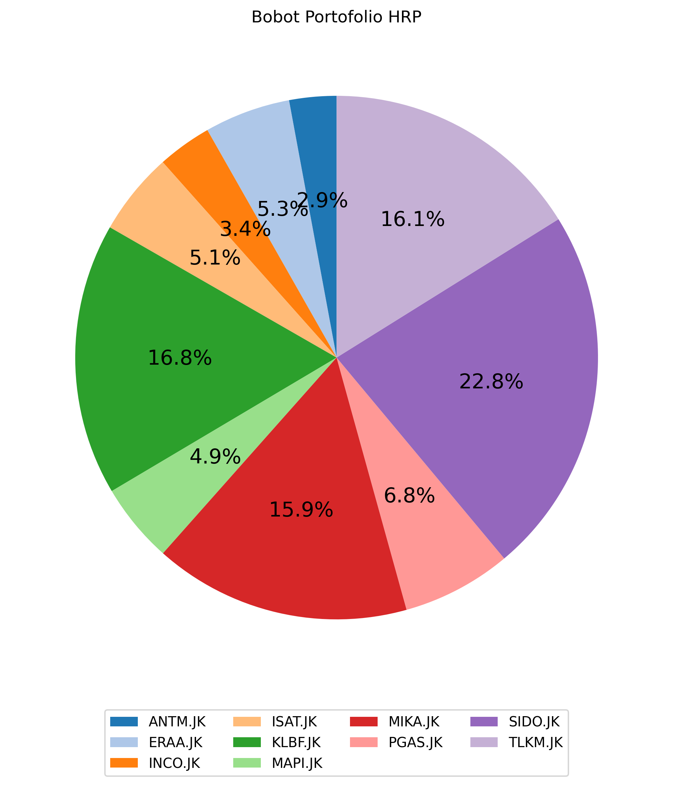

# Islamic Stock Portfolio Optimization Using Hierarchical Risk Parity (HRP)

## Overview

This project focuses on optimizing an Islamic stock portfolio using the **Hierarchical Risk Parity (HRP)** method. The analysis combines stock selection based on Long Short-Term Memory (LSTM) forecasting results with risk-based portfolio optimization to construct a diversified investment portfolio.

The study uses historical weekly Adjusted Closing Price data from selected stocks listed in the Jakarta Islamic Index 70 (JII70) over the period **December 1, 2019 – November 30, 2024**.

The stock selection process is based on two main criteria: stocks must have been consistently listed in JII70 throughout the research period and must demonstrate positive forecasted returns based on the LSTM model.

After the selection process, ten stocks are included in the portfolio optimization using HRP. This method applies hierarchical clustering, quasi-diagonalization, and recursive risk allocation to determine portfolio weights based on the relationships and risk characteristics of the selected stocks.

## Objectives

The main objectives of this project are:

- Identify stocks that were consistently listed in JII70 throughout the research period.
- Select stocks with positive forecasted returns based on the LSTM model.
- Analyze historical stock price movements and calculate weekly log returns.
- Examine correlations and relationships among the selected stocks.
- Apply hierarchical clustering to identify groups of stocks with similar return characteristics.
- Determine asset ordering through the quasi-diagonalization process.
- Optimize portfolio allocation using the Hierarchical Risk Parity (HRP) method.
- Evaluate portfolio risk distribution through risk contribution analysis.

## Stock Selection Criteria

The stocks included in this project were selected based on two main criteria:

### 1. Consistently Listed in JII70

The selected stocks must have been consistently included in the Jakarta Islamic Index 70 (JII70) throughout the research period, from December 1, 2019, to November 30, 2024.

This criterion ensures that all selected stocks meet the index membership requirement during the entire observation period.

### 2. Positive LSTM Forecasting Results

The selected stocks must also demonstrate positive forecasted returns based on the Long Short-Term Memory (LSTM) model.

Only stocks with positive forecasted returns are included in the portfolio optimization process. This criterion is intended to focus the analysis on stocks with favorable forecasted price movements.

Based on these criteria, ten stocks were selected for further analysis using the HRP method.

## Selected Stocks

The following ten stocks met the established selection criteria and were included in the portfolio optimization process.

| No. | Stock Code | Company Name |
|---|---|---|
| 1 | ANTM | PT Aneka Tambang Tbk |
| 2 | ERAA | PT Erajaya Swasembada Tbk |
| 3 | INCO | PT Vale Indonesia Tbk |
| 4 | ISAT | PT Indosat Tbk |
| 5 | KLBF | PT Kalbe Farma Tbk |
| 6 | MAPI | PT Mitra Adiperkasa Tbk |
| 7 | MIKA | PT Mitra Keluarga Karyasehat Tbk |
| 8 | PGAS | PT Perusahaan Gas Negara Tbk |
| 9 | SIDO | PT Industri Jamu dan Farmasi Sido Muncul Tbk |
| 10 | TLKM | PT Telkom Indonesia (Persero) Tbk |

## Dataset

The dataset consists of historical weekly Adjusted Closing Price data for the ten selected stocks.

**Dataset Information:**

- **Market:** Indonesia Stock Exchange (IDX)
- **Index Reference:** Jakarta Islamic Index 70 (JII70)
- **Period:** December 1, 2019 – November 30, 2024
- **Frequency:** Weekly
- **Price Variable:** Adjusted Closing Price
- **Number of Stocks:** 10

Adjusted Closing Price is used to account for corporate actions and provide a more consistent representation of historical stock prices.

## HRP Model Configuration

The following parameters are used in the portfolio optimization process:

| Parameter | Configuration |
|---|---|
| Portfolio Model | HRP |
| Codependence Method | Pearson |
| Clustering Linkage | Average |
| Risk Measure | Mean Variance (MV) |
| Risk-Free Rate | 6% |
| Return Type | Log Return |
| Data Frequency | Weekly |

## Portfolio Allocation Results

The HRP optimization produces the following asset allocation across the ten selected stocks.

| Stock Code | HRP Weight | Allocation (%) |
|---|---:|---:|
| ANTM | 0.029168 | 2.9168% |
| ERAA | 0.053158 | 5.3158% |
| INCO | 0.033501 | 3.3501% |
| ISAT | 0.051271 | 5.1271% |
| KLBF | 0.168066 | 16.8066% |
| MAPI | 0.049212 | 4.9212% |
| MIKA | 0.158778 | 15.8778% |
| PGAS | 0.067644 | 6.7644% |
| SIDO | 0.227861 | 22.7861% |
| TLKM | 0.161341 | 16.1341% |
| **Total** | **1.000000** | **100.0000%** |

The allocation results show that SIDO receives the largest portfolio weight at 22.7861%, followed by KLBF at 16.8066%, TLKM at 16.1341%, and MIKA at 15.8778%.

These weights represent the relative capital allocation determined by the HRP optimization process based on the risk structure and relationships among the selected stocks.

### Portfolio Allocation Visualization

## Conclusion

This project demonstrates a combined stock selection and portfolio optimization approach using LSTM forecasting and Hierarchical Risk Parity (HRP).

The selection process identifies ten stocks that were consistently listed in JII70 throughout the research period and demonstrated positive forecasted returns based on the LSTM model.

Subsequently, HRP is applied to determine portfolio weights by considering the hierarchical relationships and risk characteristics of the selected stocks.

The resulting portfolio allocation provides insights into asset distribution, diversification, and risk management in the Indonesian Islamic stock market.

## Disclaimer

This project is intended for educational, research, and analytical purposes only. The results do not constitute financial or investment advice. Historical stock performance and model-based forecasts do not guarantee future returns. Investment decisions should be made based on individual financial objectives and risk tolerance.
